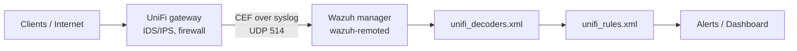

# UniFi → Wazuh: IDS/IPS, firewall and Wi‑Fi alerts

Send logs from a UniFi Cloud Gateway (UCG Fiber, UCG Ultra/Max, UDM, UXG) to a Wazuh manager, decode the UniFi CEF format, and raise alerts for IDS/IPS detections, firewall events and Wi‑Fi client activity.

Wazuh has no built-in decoder for UniFi, so this repo provides one, plus a small rule set and sample logs for testing.



## Tested with

| Component | Version |
| --- | --- |
| Gateway | UniFi Cloud Gateway Fiber, UniFi OS 5.1.34 |
| UniFi Network | 10.6.109 |
| Access point | U7 Pro (firmware 8.7.11) |
| Wazuh manager | 4.14.9, all-in-one install on Ubuntu Server 24.04 |

Other UniFi gateways that send CEF through the SIEM integration should work. The CEF fields can change between UniFi Network versions, so test with your own logs (step 4).

## Repository layout

```
decoders/unifi_decoders.xml   Wazuh decoders for UniFi CEF logs
rules/unifi_rules.xml         Rules 100200–100204
samples/unifi_sample.log      Sample log lines for wazuh-logtest
```

## Alerts you get

| Rule | Level | Fires on |
| --- | --- | --- |
| 100200 | 3 | Any UniFi CEF event |
| 100201 | 10 | IDS/IPS detection (event 200 detected, 201 blocked) |
| 100202 | 5 | Firewall events |
| 100203 | 3 | Wi‑Fi client connected / disconnected |
| 100204 | 12 | IDS/IPS detection with `UNIFIrisk=high` |

## Setup

Replace the example addresses with your own:

- `192.168.4.181`: the Wazuh server
- `192.168.4.1`: the gateway's address on the Wazuh server's VLAN (the source of the syslog packets)

### 1. Turn on IDS/IPS in UniFi

**Settings → CyberSecure → Protection**: turn on Intrusion Prevention, select the networks to protect, and choose a detection mode.

- **Notify (IDS):** alerts only. Events arrive as `200 | Threat Detected` with `act=allowed`.
- **Notify and Block (IPS):** alerts and blocks. Events arrive as `201 | Threat Detected and Blocked`.

### 2. Point the gateway at Wazuh

**Settings → CyberSecure → Traffic Logging** (on some versions **Settings → Control Plane → Integrations**):

- **Activity Logging (Syslog):** SIEM Server
- **Server address:** the Wazuh server IP
- **Port:** 514
- **Contents:** Security Detections, plus any of Admin Activity, Critical, Devices, Triggers, VPN, Firewall Default Policy, Client Devices

For your own firewall policies, turn on **Syslog Logging** on each policy you want in Wazuh.

If your firewall has zone-based policies between VLANs, the gateway's own traffic to the Wazuh server is allowed by default.

### 3. Open a syslog listener in Wazuh

Add a second `<remote>` block to `/var/ossec/etc/ossec.conf`, next to the existing agent block on 1514:

```xml
<remote>
  <connection>syslog</connection>
  <port>514</port>
  <protocol>udp</protocol>
  <allowed-ips>192.168.4.1</allowed-ips>
  <local_ip>192.168.4.181</local_ip>
</remote>
```

`<local_ip>` is optional. If you use it, give the Wazuh server a fixed IP, or the listener fails to bind when the address changes.

If `ufw` is active on the server:

```bash
sudo ufw allow from 192.168.4.1 to any port 514 proto udp
```

### 4. Install the decoder and rules

```bash
sudo cp decoders/unifi_decoders.xml /var/ossec/etc/decoders/
sudo cp rules/unifi_rules.xml /var/ossec/etc/rules/
sudo chown wazuh:wazuh /var/ossec/etc/decoders/unifi_decoders.xml /var/ossec/etc/rules/unifi_rules.xml
sudo chmod 660 /var/ossec/etc/decoders/unifi_decoders.xml /var/ossec/etc/rules/unifi_rules.xml
```

Wazuh loads every `.xml` file in `etc/decoders` and `etc/rules`, so you don't need to edit `local_decoder.xml` or `local_rules.xml`. You can paste the contents into those files instead if you prefer.

Test before restarting:

```bash
sudo /var/ossec/bin/wazuh-logtest
```

Paste a line from `samples/unifi_sample.log`, including the `Nov 03 12:31:10 UCG-Fiber` header. The first line should show:

```
**Phase 1: Completed pre-decoding.
	program_name: 'CEF'
**Phase 2: Completed decoding.
	name: 'unifi-cef'
	unifi.signature: 'ET USER_AGENTS Suspicious User Agent (BlackSun)'
	...
**Phase 3: Completed filtering (rules).
	id: '100204'
	level: '12'
**Alert to be generated.
```

Then apply:

```bash
sudo systemctl restart wazuh-manager
```

### 5. Test end to end

From a machine on a network covered by IDS/IPS:

```bash
curl -A "BlackSun" http://www.example.com
```

The fake user agent trips a standard Emerging Threats signature. Within a minute:

```bash
sudo grep '"unifi"' /var/ossec/logs/alerts/alerts.json | tail -3
```

In the Wazuh dashboard, open **Threat Hunting** and filter on `rule.groups:unifi`, or `rule.groups:ids` for intrusion alerts only.

## Decoded fields

| Field | From | Example |
| --- | --- | --- |
| `unifi.event_id` | CEF header | `200` |
| `unifi.name` | CEF header | `Threat Detected` |
| `unifi.severity` | CEF header | `9` |
| `unifi.category` | `UNIFIcategory` | `Security`, `Client Devices` |
| `unifi.subcategory` | `UNIFIsubCategory` | `Intrusion Prevention` |
| `unifi.policy_type` | `UNIFIpolicyType` | `IDS/IPS` |
| `unifi.action` | `act` | `allowed`, `blocked` |
| `unifi.risk` | `UNIFIrisk` | `high` |
| `unifi.signature` / `signature_id` | `UNIFIipsSignature` / `Id` | `ET USER_AGENTS …` / `2008983` |
| `unifi.dst_domain` | `UNIFIdstDomain` | `www.example.com` |
| `unifi.src_hostname` / `src_alias` | `UNIFIsrcClientHostname` / `Alias` | `ubuntu-server` |
| `unifi.client_hostname` / `client_ip` / `client_mac` | `UNIFIclient*` | Wi‑Fi events |
| `unifi.ssid` / `unifi.network` | `UNIFIwifiName` / `UNIFInetworkName` | `IoT-WiFi` / `IoT VLAN` |
| `unifi.msg` | `msg` | UniFi's own summary sentence |
| `srcip`, `srcport`, `dstip`, `dstport` | `src`, `spt`, `dst`, `dpt` | Standard Wazuh fields |

## Troubleshooting

Work through these in order. Each one rules out a layer.

| Symptom | Check | Fix |
| --- | --- | --- |
| Nothing arrives | `sudo tcpdump -ni any udp port 514` shows no packets | Recheck the SIEM Server address and port in UniFi and click **Apply Changes**; check that IDS/IPS covers the network you test from |
| tcpdump shows `(invalid)` | Normal | UniFi sends no `<priority>` prefix; Wazuh still accepts it |
| Packets arrive, no alerts | `sudo grep -iE "syslog\|not allowed" /var/ossec/logs/ossec.log` | Put the packet's real source IP (from tcpdump) in `<allowed-ips>` |
| Still no alerts | Set `<logall>yes</logall>` under `<global>`, restart, then `sudo grep "CEF:0" /var/ossec/logs/archives/archives.log` | If lines appear, the decoder isn't matching: test one in `wazuh-logtest` |
| `No decoder matched` | Phase 1 shows `program_name: 'CEF'` | The parent decoder must match on `<program_name>CEF</program_name>`. A prematch on the full `CEF:0\|…` text fails, because the header has already been stripped |
| IDS alert only at level 3 | The event is `200`, not `201` | IDS (detect-only) mode sends event 200 and has no `UNIFIsubCategory`; rule 100201 matches both event IDs |
| Empty source in the description | No `src=` field | Known clients are sent as `UNIFIsrcClient*`; the descriptions use `unifi.msg`, which always names both ends |
| Your own `grep` shows up as an alert | Rule 5402 "Successful sudo to ROOT" | Search on `'"unifi"'` (the rule group), not the word "ubiquiti" |

Set `<logall>no</logall>` again when you're done. It writes every event to disk.

## Notes

- `wazuh-logtest` reads the files directly, but the running manager only loads changes on restart.
- Level 12 alerts are flagged `mail: true`. Nothing is sent unless email is configured in Wazuh.
- Run IDS in detect-only mode for a week or two, suppress false positives in UniFi, then switch to block mode.
- `samples/unifi_sample.log` uses documentation IPs and anonymized names. The first, third and fourth lines are trimmed real events; the second (event 201) is illustrative, built from the same format.

## License

MIT
